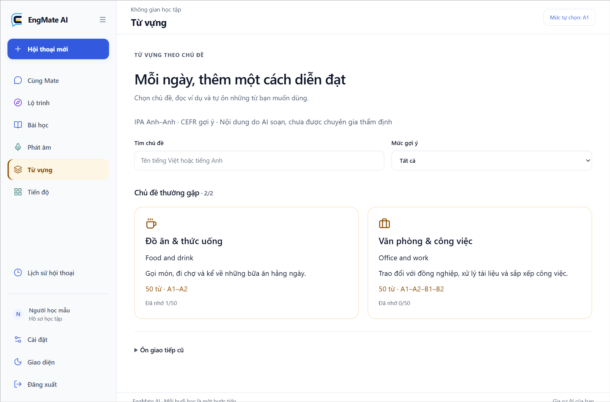
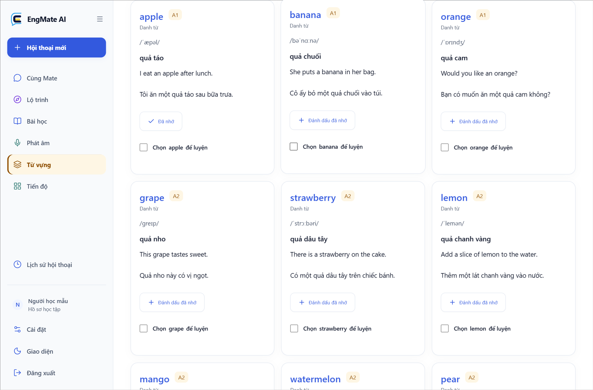
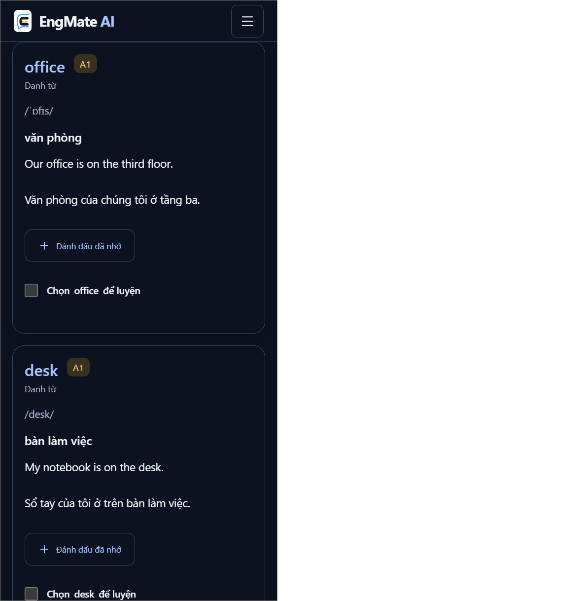
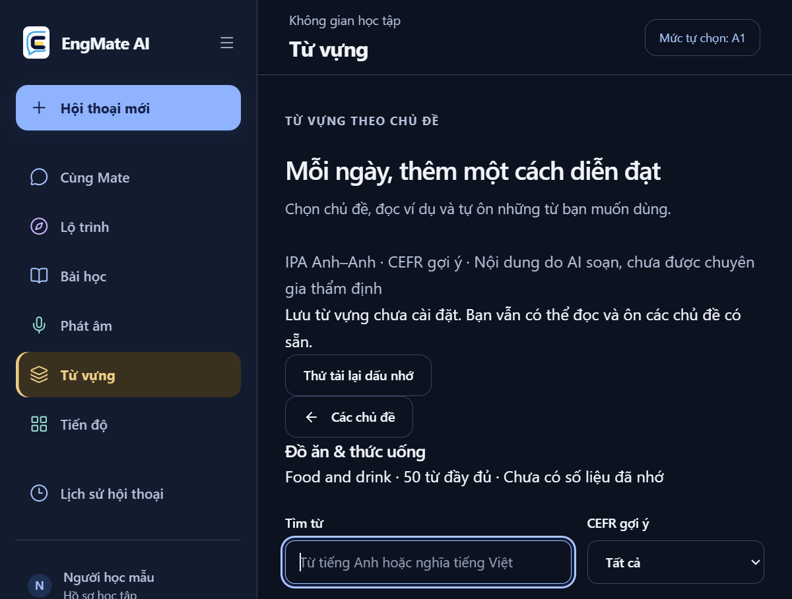

# Phiếu xem ảnh và rà hai chủ đề Từ vựng

**Chưa nghiệm thu cuối; trạng thái ghi ngày 17/11/2026.** Đây là dữ liệu mẫu,
không phải tài khoản hoặc DB ứng dụng đang demo. Mã feature ở worktree riêng;
Docker demo đang source-mount từ worktree (xác nhận lần cuối 16/11/2026), chưa
merge/build image.

## Phạm vi xin rà

- Đồ ăn & thức uống: **50 từ**, A1–A2 gợi ý.
- Văn phòng & công việc: **50 từ**, A1–B2 gợi ý.
- IPA Anh–Anh; nội dung AI soạn/chưa chuyên gia thẩm định.
- Tìm/lọc, tự đánh dấu nhớ, thẻ/quiz, chọn tối đa 5 từ tạo draft Mate.
- Không AI generation, ôn giãn cách, điểm TOEIC mới hoặc 16 chủ đề còn lại.

## Ảnh UI

Ảnh chụp bằng browser Desktop. Desktop iframe thực đo 1364×899 CSS px,
mobile 374×811, fallback 800×606. Pixel ảnh có scale khác CSS px.
Khoảng trắng bên phải ảnh mobile thuộc harness iframe, không phải overflow
của trang vocabulary. Nội dung dài cuộn bình thường; ảnh chỉ cho thấy vùng chụp.

### Chủ đề — desktop sáng

### Danh sách từ — desktop sáng, sau sửa label

### Văn phòng — mobile tối, sau sửa label

### Thiếu bảng mới — vẫn đọc và ôn

## Phiếu nội dung

[CSV 17 mục](VOCABULARY_CONTENT_REVIEW_2026-11-16.csv): random 5/50 mỗi chủ đề
(10%), cộng 7 mục có cờ, không lặp. Seed tái lập `20261116:<topic_id>`.
Các trường nội dung đã đối chiếu đúng catalog; ghi chú sơ bộ không phải xác nhận
đúng IPA/CEFR hoặc thẩm định chuyên môn. Tất cả vẫn **Chờ người duyệt**.
Nếu mở bằng Excel, chọn import UTF-8 và dấu phân cách dấu phẩy.

Người rà kiểm: nghĩa đúng ngữ cảnh/từ loại, IPA Anh–Anh và biến thể, trọng âm,
ví dụ tự nhiên/chứa đúng mục từ, dịch tương ứng, CEFR chỉ gợi ý; ghi rõ sửa mục
nào. Những mục có cờ không mặc nhiên là lỗi đã xác nhận.

## Cổng còn lại trước nghiệm thu

- [ ] Người dùng duyệt bố cục/luồng hai chủ đề qua ảnh và browser.
- [ ] Người rà duyệt CSV, quyết định sửa nội dung có cờ hoặc giữ nhãn chưa thẩm định.
- [ ] Gate coverage/build sau CSS hoàn tất, không lỗi ngoài ngoại lệ đã duyệt.
- [ ] Chốt phạm vi demo: fixture offline hay backend/DB test được duyệt.
- [ ] Ghi rõ giới hạn motion: đã kiểm bật/tắt Settings bằng keyboard nhưng hệ
      điều hành đang yêu cầu reduce, chưa có môi trường no-preference/điện thoại thật.

Không tự đánh dấu checklist đã xong để kịp demo.
[Trạng thái kỹ thuật và cách demo an toàn](VOCABULARY_DEMO_HANDOFF_2026-11-16.md).
